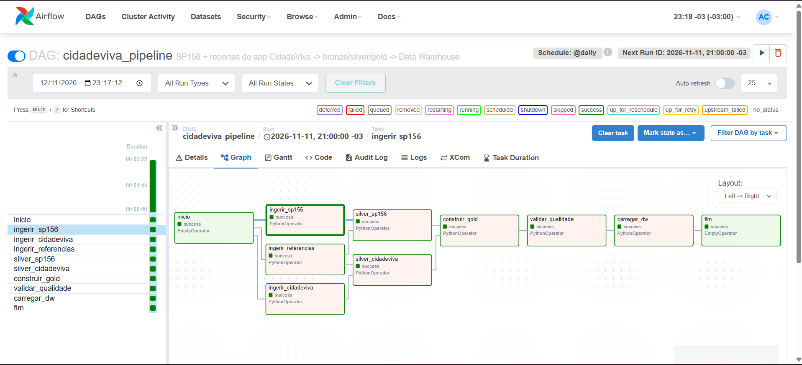

# CidadeViva — Pipeline de Dados

**Global Solution FIAP 2026.2 · CitizenTech · Engenharia de Software (4º ano)**
Disciplina: Big Data Architecture & Data Integration · Prof.ª Ana Machado · Atividade: *Pipeline de Dados do MVP CitizenTech*

| Integrante | RM |
|---|---|
| Giovanna Franco Gaudino Rodrigues | RM553701 |
| Rafael de Almeida Sigoli | RM554019 |
| Rafael Jorge Del Padre | RM552765 |

| Links | |
|---|---|
| MVP no ar | https://citizentech-girafas.azurewebsites.net |
| Repositório do MVP | https://github.com/girafasfiap-cyber/GS_CitizenTech_MVP_Startup |
| Documento da entrega (PDF, ABNT) | [`docs/CidadeViva_Arquitetura_e_Dicionario_de_Dados.pdf`](docs/CidadeViva_Arquitetura_e_Dicionario_de_Dados.pdf) |
| Mesmo documento em Word | [`docs/CidadeViva_Arquitetura_e_Dicionario_de_Dados.docx`](docs/CidadeViva_Arquitetura_e_Dicionario_de_Dados.docx) |

## Em uma frase

O **CidadeViva** é um app onde o cidadão reporta problemas urbanos (buraco, lâmpada apagada, bueiro entupido). Este pipeline
junta **o histórico real de pedidos da Prefeitura de SP (SP156)** com **os reportes feitos no app**, limpa e confere tudo, e
entrega num **Data Warehouse** que alimenta o mapa de demanda, a fila de revisão humana da IA e a priorização do RPA.
Tudo com ferramentas gratuitas: Python, pandas, Apache Airflow e PostgreSQL.

## Como funciona

```
 SP156 (Prefeitura) ──► ingerir_sp156 ───────► silver_sp156 ───────┐
 App CidadeViva ──────► ingerir_cidadeviva ──► silver_cidadeviva ──┼─► construir_gold ─► validar_qualidade ─► carregar_dw
 Seeds (referências) ─► ingerir_referencias ─► (usadas pelas duas) ┘
```

1. **Bronze**: guarda o dado original sem mexer, com um manifest (origem, nº de registros, hash).
2. **Silver**: limpa e padroniza (datas, coordenadas, duplicados), classifica por categoria e esconde dados pessoais.
3. **Gold**: monta as tabelas de consulta (modelo estrela: 3 dimensões, 2 fatos, 2 marts).
4. **Qualidade**: 19 verificações automáticas. Se alguma falhar, a carga **não** acontece.
5. **Carga**: grava no PostgreSQL. Rodar a DAG de novo **não duplica** dados (idempotência).

Os detalhes, o dicionário de dados de todas as tabelas e os prints estão no PDF da entrega.

## Fontes de dados

| Fonte | De onde vem | Para que serve |
|---|---|---|
| **SP156** | Portal de Dados Abertos da Prefeitura de SP (CSV trimestral, licença CC0). Tenta a **API do portal (CKAN)** e, se falhar, usa os CSVs locais | Histórico real de demanda por subprefeitura e categoria |
| **Reportes do CidadeViva** | **API do app em produção** (`GET /reportes/export`, protegida por chave). O simulador só entra se a API não estiver configurada | Triagem por IA, revisão humana, envio pelo RPA |
| **Seeds** | `seeds/` (subprefeituras, categorias, regras de classificação) | Taxonomia única para as duas fontes |

## Integração com o app (MVP)

O pipeline é *batch*: o app registra o reporte na hora e o pipeline o leva ao Data Warehouse quando roda (DAG `@daily`).

| Sentido | Como |
|---|---|
| **App → pipeline** | `ingerir_cidadeviva` chama `GET {CIDADEVIVA_API_URL}/reportes/export?desde=<ds>&ate=<ds>` com o cabeçalho `X-API-Key` (`CIDADEVIVA_API_KEY`). |
| **Pipeline → app** | O painel `/painel` do MVP lê um DW SQLite enxuto (`dim_subprefeitura`, `dim_categoria`, `mart_demanda_subprefeitura_mes`), gerado por `tools/enxugar_dw.py` do repositório do MVP. |

**Rastreabilidade** (de onde veio cada partição, conforme o `_manifest.json`):

| Data lógica | Origem | Registros |
|---|---|---|
| 2026-11-12 e 2026-11-13 | simulador (antes do app estar no ar) | 408 em cada |
| 2026-11-17 | app em produção | 0 (dia sem reportes) |
| 2026-11-18 | app em produção | 1 (reporte real de teste) |

**Fuso horário.** O app grava em UTC. Na silver, o horário é convertido para Brasília, para casar com as datas do SP156.
Por isso um reporte feito às 22h52 do dia 17 (Brasília) fica com `data_id` 20261117, mas é lido na partição `dt=2026-11-18` (UTC).

## Resultado da execução de entrega (Airflow no Docker, data lógica 18/11/2026)

| Item | Valor |
|---|---|
| Tasks da DAG | 10, todas em `success` |
| Linhas lidas do SP156 (3 arquivos de 2026) | 1.525.907 |
| Solicitações de zeladoria mantidas | 472.524 (99,5% com subprefeitura reconhecida) |
| Verificações de qualidade | 19 aprovadas, 0 falhas |
| `fato_solicitacao_sp156` | 472.524, e continua 472.524 depois de reexecutar a DAG |
| Demais tabelas | `dim_data` 321 · `dim_subprefeitura` 32 · `dim_categoria` 7 · `mart_demanda_subprefeitura_mes` 1.885 · `fato_reporte` 1 · `mart_triagem_ia` 1 |

> **Transparência sobre a API do SP156 no Docker.** Fora do Docker, a ingestão usou a API do portal. Dentro do Docker, a rede
> do ambiente reassina o HTTPS e a API foi recusada com `CERTIFICATE_VERIFY_FAILED` (certificado autoassinado na cadeia).
> O pipeline usou, como projetado, o *fallback* dos CSVs locais (`fonte_usada: local` no manifest). A verificação de
> certificado **não** foi desativada.

## Evidências (prints do Airflow e do banco)

Todos em [`docs/evidencias/`](docs/evidencias/) e também no Apêndice A do PDF.

| # | Arquivo | O que mostra |
|---|---|---|
| 1 | `01_AirFlow_dag_graph.png` | Graph da DAG com as 10 tasks concluídas |
| 2 | `02_AirFlow_gantt.png` | Gantt: duração de cada task e paralelismo das ingestões |
| 3 | `03_ingerir_sp156.png` | Log da ingestão do SP156 (tentativa da API e uso dos CSVs locais) |
| 4 | `04_ingerir_cidadeviva.png` | Log da leitura do app em produção |
| 5 | `05_silver_sp156.png` | Log da silver: linhas lidas, descartadas e classificadas por categoria |
| 6 | `06_validar_qualidade.png` | Log do gate de qualidade: 19 verificações aprovadas |
| 7 | `07_carregar_dw.png` | Log da carga com a contagem de linhas por tabela |
| 8 | `08_contagem_solicitacao.png` | Consulta no DW: 472.524 linhas em `fato_solicitacao_sp156` |
| 9 | `09_idempotencia_reexecucao.png` | Mesma consulta depois de reexecutar a DAG: continua 472.524 |



## Como executar

Passo a passo para Windows em [`COMO_RODAR.md`](COMO_RODAR.md). Resumo:

**A) Com Airflow (Docker), o caminho da entrega**

```bash
cp .env.example .env          # edite: CIDADEVIVA_API_URL e CIDADEVIVA_API_KEY (a chave NÃO vai para o Git)
docker compose up airflow-init
docker compose up -d
# Airflow: http://localhost:8080 (admin / admin) -> DAG cidadeviva_pipeline -> Trigger
# DW:      psql -h localhost -p 5433 -U dw -d cidadeviva_dw   (senha: dw)
```

Coloque os CSVs do SP156 em `data/raw/` (eles são o *fallback* e **não** vão para o Git). Sem `CIDADEVIVA_API_URL`, o pipeline usa o simulador.

**B) Sem Airflow (rápido, grava em SQLite)**

```bash
pip install -r requirements.txt
export SP156_LOCAL_PATH="data/raw/arquivo-final-*-trim-26.csv"
python scripts/run_local.py --ds 2026-11-18
pytest -q                      # 13 testes
python docs/gerar_pdf.py       # regera o PDF com os números da sua execução
python docs/gerar_docx.py      # idem em Word
```

Sem os CSVs (ex.: avaliador): `SP156_MODE=sample python scripts/run_local.py --ds 2026-11-12` usa a amostra **sintética**.

**Variáveis principais**

| Variável | Para que serve |
|---|---|
| `SP156_FONTE` | `auto` (padrão: API e, se falhar, CSVs), `api` (só API) ou `local` (só CSVs) |
| `SP156_LOCAL_PATH` | Caminho dos CSVs do *fallback* (aceita glob) |
| `SP156_MODE` | `real` (padrão) ou `sample` (amostra sintética, só para testes) |
| `CIDADEVIVA_API_URL` / `CIDADEVIVA_API_KEY` | API do app em produção (vazio = simulador) |
| `HASH_SALT` | Sal do hash do usuário (LGPD) |

### Problemas conhecidos

| Sintoma | Causa e solução |
|---|---|
| `failed to connect to the docker API` | Docker Desktop fechado. Abra e espere "Engine running". |
| `ingerir_sp156` falha com caminho `data/raw/...` no Docker | Variável do terminal sobrepõe o `.env`. Rode `unset SP156_LOCAL_PATH` e `docker compose up -d --force-recreate`. |
| `API do portal indisponível ... CERTIFICATE_VERIFY_FAILED` | Rede com inspeção de HTTPS. O *fallback* para CSVs cobre o caso (veja `fonte_usada` no manifest). |
| `Não autorizado` ao ler o app | `CIDADEVIVA_API_KEY` ausente ou diferente da chave do app. |
| Contagens duplicadas em `fato_reporte` / `mart_triagem_ia` | Essas tabelas acumulam uma partição por data de execução. Para uma demonstração limpa: `docker compose down -v` e uma única execução. |

## Decisões de projeto

* **Idempotência**: toda task recebe só a data lógica (`ds`). O SP156 (retrato completo do ano) **substitui** `fato_solicitacao_sp156` e o mart de demanda; os reportes do app removem só a partição `dt_ingestao=<ds>`. Rodar de novo não duplica (coberto por testes).
* **Dados não trafegam por XCom**: o contrato entre tasks é o data lake em disco.
* **Qualidade como gate**: 19 verificações (chaves, completude, domínio, coordenadas, LGPD) param a DAG antes da carga. Relatório em `data/gold/dt=<ds>/_dq_report.json`.
* **Dia sem reportes não é falha**: só se o app confirmar `registros: 0` no manifest. Vazio sem essa confirmação continua falhando, para não esconder uma ingestão quebrada.
* **LGPD**: nome e e-mail nunca chegam à silver (viram `usuario_hash`, SHA-256 + salt); telefone, CPF e e-mail digitados no texto são mascarados.
* **IA responsável**: confiança < 0,70 (ou categoria inválida) marca `requer_revisao_humana = 1`; `mart_triagem_ia` acompanha a taxa por categoria.
* **SP156**: só entram solicitações de zeladoria (7 categorias, regras em `seeds/regras_categoria_sp156.csv`); o resto é descartado e contabilizado em `_stats.json`. O pipeline aceita os dois layouts de 2026 e detecta separador, codificação e formato de data por arquivo.
* **Sem deduplicação por conteúdo no SP156**: o CSV não tem protocolo; cada linha é uma solicitação (`id = arquivo:linha`).

## O que é real e o que é simulado

* **SP156: dados reais** (Portal de Dados Abertos da PMSP, CC0). A amostra sintética existe só para os testes.
* **Reportes do app**: reais a partir de 17/11/2026, mas são de **teste** (ainda não há usuários reais). As partições de 12 e 13/11 vieram do **simulador**, que injeta sujeira de propósito.
* **Postgres (Airflow) e SQLite (`run_local.py`)** são caminhos separados; a cópia do SQLite enxuto para o painel do MVP é manual.
* Os centroides das subprefeituras (`seeds/`) são **aproximados**, não limites oficiais do GeoSampa.
* As regras de classificação do SP156 são lexicais; confira `_stats.json` para os serviços não classificados.

## Estrutura

```
dags/cidadeviva_pipeline.py   DAG do Airflow
pipeline/                     ingest · transform · gold · quality · load · config · utils
seeds/                        subprefeituras, categorias, regras de classificação
data/sample/                  amostra sintética (só testes)
scripts/                      run_local.py e utilitários
sql/consultas_exemplo.sql     consultas que o MVP executa
tests/                        13 testes (utilitários, pipeline ponta a ponta, idempotência, integração com o app)
docs/                         PDF/Word, gerador (conteudo.py + gerar_pdf.py + gerar_docx.py), diagramas, evidências
docker-compose.yml            Airflow + Postgres (metadados) + Postgres (DW)
```
